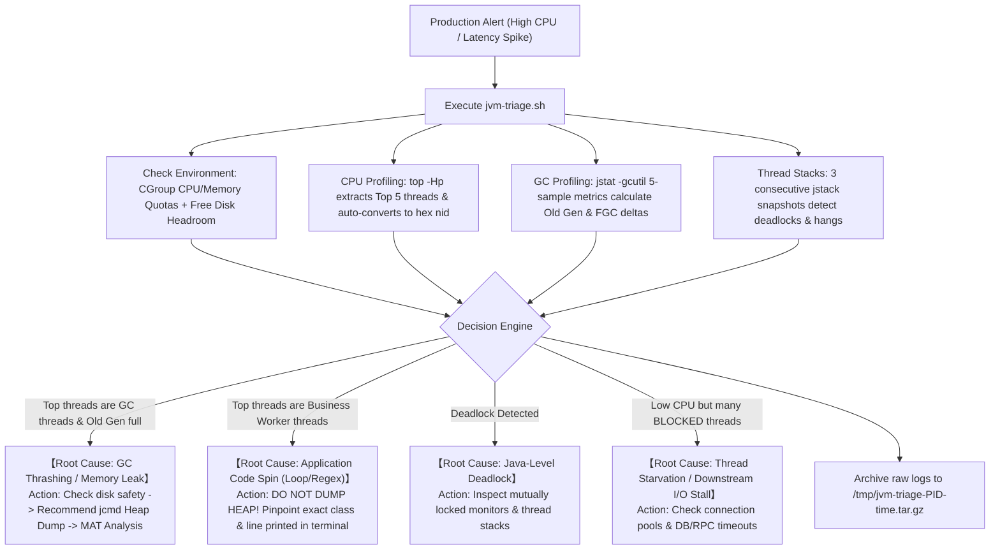

# JVM-Triage: Production JVM Incident Triage & Scene Preservation Toolkit

> **Stop panicking during production JVM emergencies.**
> Zero dependencies. Pure Shell. Non-intrusive. Generates objective root-cause triage reports in 3~5 seconds to prevent scene destruction and secondary disasters.

English | [简体中文](./README_zh.md)

---

## Common Pitfalls in Production JVM Troubleshooting

1. **Confusing Symptoms with Root Causes**: Developers often mistake a 100% CPU spike for an application infinite loop, only to realize hours later that the Old Generation was exhausted and garbage collection threads (`VM Thread` / `GC Task Thread`) were thrashing in non-stop Full GCs.
2. **Blind Restarts Destroying Evidence**: Restarting an unhealthy container or pod wipes out JVM heap dumps, thread stacks, and telemetry, leaving the real culprit unsolved.
3. **High-Risk Commands Causing Node Outages**: Running `jmap -dump:live` blindly on a large heap (8GB~32GB) freezes production traffic for minutes (extended STW) and risks crashing the entire host node if disk space fills up.
4. **Tedious Manual Calculations**: Converting decimal thread IDs from `top -Hp` to hexadecimal `nid` and grepping through massive `jstack` files wastes precious minutes during an outage.

---

## What Does `jvm-triage` Do?

`jvm-triage` codifies industry-standard **SRE & JVM Incident Playbooks** into an automated, safe 3~5 second triage flow:



---

## Key Features

- ⚡ **Zero Third-Party Dependencies**: Pure Bash. Relies only on standard POSIX commands and standard JDK tools (`jstat`, `jstack`, `jcmd`). No Python, agent daemons, or runtime installations required.
- 🛡️ **Safety-First Guardrails**: Automatically verifies available disk space before suggesting a heap dump. Recommends modern, lower-overhead `jcmd` instead of dangerous `jmap` variants.
- 🔍 **Interactive Multi-Process Detection**: When multiple Java processes are running, it automatically extracts **PID + Jar Name / Main Class** for clear interactive selection.
- 📊 **5-Sample GC & 3-Snapshot jstack Diagnostics**:
  - 5-sample GC telemetry calculates the actual rate of Full GC occurrences over 5 seconds.
  - 3 thread snapshots (2s interval) distinguish genuinely stuck/deadlocked threads from normally executing ones.
- 🤖 **AI Agent Skill Included**: Includes a standardized `skills/jvm-triage/SKILL.md` for tools like Antigravity, Claude Code, and Cursor to correlate reports with local repository code.

---

## Quick Start

### 1. One-Line Remote Execution

Run directly on any target server:

```bash
# Auto-detect Java processes and launch triage
curl -fsSL https://raw.githubusercontent.com/b1n9bna/jvm-triage/main/scripts/jvm-triage.sh | bash

# Or specify a target PID and custom output directory
curl -fsSL https://raw.githubusercontent.com/b1n9bna/jvm-triage/main/scripts/jvm-triage.sh | bash -s -- <PID> /tmp
```

### 2. Local Clone

```bash
git clone https://github.com/b1n9bna/jvm-triage.git
cd jvm-triage/scripts
chmod +x jvm-triage.sh

# Interactive mode
./jvm-triage.sh

# Direct PID mode
./jvm-triage.sh 18422
```

---

## Multi-Process Interactive Selection

When multiple Java processes are present, the script presents a clean menu:

```text
Detected multiple Java processes. Please select the target to inspect:
--------------------------------------------------------------------------------
  [1] PID: 18422   | user-service.jar (org.springframework.boot.loader.JarLauncher)
  [2] PID: 20105   | dubbo-provider.jar
  [3] PID: 24890   | org.apache.zookeeper.server.quorum.QuorumPeerMain
--------------------------------------------------------------------------------
Enter selection [1-3] (or 'q' to quit): 1
```

---

## Terminal Report Preview

```text
================================================================================
                       JVM-TRIAGE INCIDENT REPORT
================================================================================
[1] System & Runtime Baseline
  - Target Process : PID 18422 (Uptime: 14d 06:32:10)
  - System LoadAvg : 7.82, 6.14, 4.30
  - CGroup Limits  : CPU: 4.0 Cores | Memory: 4096 MB
  - Disk Headroom  : 32.5 GB available on /tmp/jvm-triage-18422-20261111_173000

[2] Telemetry & Vital Signs
  - Overall CPU    : 385%
  - Memory Usage   : Eden: 100.00% | Old: 99.82% | Metaspace: 142.10MB
  - GC 5s Activity : YGC: 1420 | FGC Delta: +3 (FGCT Delta: +2.18s)
  - Thread States  : Total: 280 | RUNNABLE: 42 | BLOCKED: 0 | WAITING: 238

[3] Top CPU Threads & Hotspot Stack Traces
  [#1] TID: 18430 | nid: 0x47fe | CPU: 96.2%
    Header: "VM Thread" os_prio=0 tid=0x00007f9c2c092800 nid=0x47fe runnable
  [#2] TID: 18431 | nid: 0x47ff | CPU: 95.1%
    Header: "GC Task Thread#0 (ParallelGC)" os_prio=0 tid=0x00007f9c2c01e000 nid=0x47ff runnable

[4] Root Cause Diagnosis & Decision Matrix
  >>> Category     : GC_THRASHING_AND_MEMORY_LEAK
  >>> Summary      : Severe GC Thrashing detected. High CPU usage is driven by JVM GC threads (Old Gen: 99.82%, FGC Count Delta: +3 in 5s).
  >>> Next Actions : Potential memory leak or insufficient heap. High CPU is a SYMPTOM, not the cause. Generating a heap dump is strongly recommended for MAT analysis.

[5] Safe Operation Guide
  [+] Heap dump recommended. Disk headroom is safe (32.5 GB available).
  [+] Recommended Non-Intrusive Dump Command:
      jcmd 18422 GC.heap_dump /tmp/jvm-triage-18422-20261111_173000/heap_dump_18422.hprof
      (Note: Brief STW pause may occur. If in K8s, drain/isolate pod traffic first if possible)

[6] Archive & Evidence Preservation
  Raw snapshots saved to: /tmp/jvm-triage-18422-20261111_173000
================================================================================

✓ Scene preserved successfully!
Diagnostic bundle created: /tmp/jvm-triage-18422-20261111_173000.tar.gz
```

---

## AI Agent Integration

The repository includes `skills/jvm-triage/SKILL.md`.
* Copy the `skills/jvm-triage` directory into your agent skills path (e.g., `~/.gemini/antigravity-cli/skills/` or Cursor / Claude Code configuration).
* Paste the terminal report from `jvm-triage.sh` into your AI chat.
* The Agent will automatically classify the archetype, match stack traces with local files to find buggy loops, or walk you through Eclipse MAT Dominator Tree analysis.

---

## Repository Structure

```text
jvm-triage/
├── scripts/
│   └── jvm-triage.sh          # One-click triage & scene preservation script
├── skills/
│   └── jvm-triage/
│       └── SKILL.md           # AI Agent SRE diagnostic knowledge base
├── LICENSE                    # Apache 2.0
├── README.md                  # English Documentation
└── README_zh.md               # Chinese Documentation
```

## License

Licensed under the [Apache License 2.0](LICENSE). Contributions, issues, and feature suggestions are welcome!
