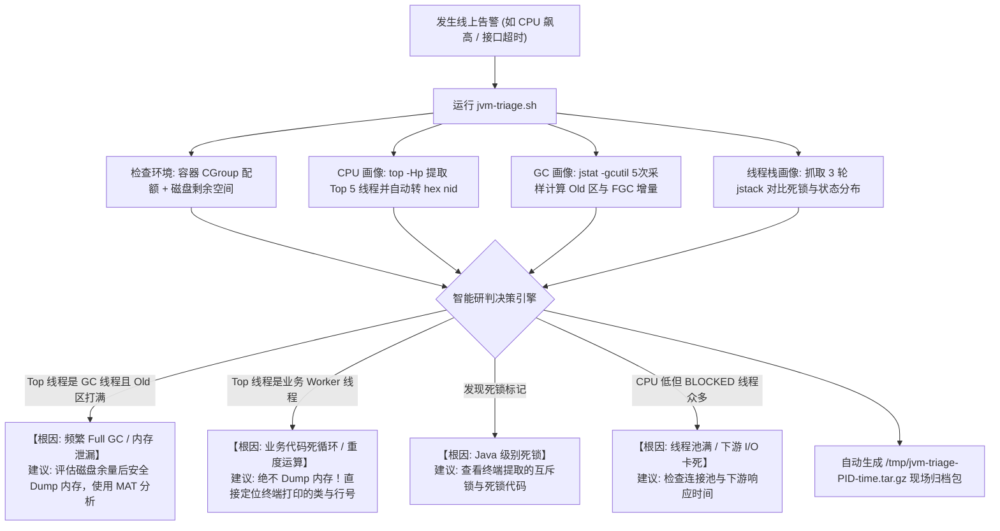

# JVM-Triage: 线上 JVM 事故一键分诊与现场保全工具

> **面对线上 CPU 飙高、频繁 Full GC、内存泄漏、线程死锁，不再手忙脚乱。**
> 零依赖、纯 Shell、零侵入、3~5 秒生成客观研判报告，杜绝因盲目重启丢失现场或因盲目 Dump 引发次生灾害。

[English](./README.md) | 简体中文

---

## 线上排障的常见误区与痛点

1. **错把表象当根因**：看到 CPU 接近 100%，以为是代码写了死循环；排查半天才发现是 Old 区打满，垃圾回收线程（`VM Thread` / `GC Task Thread`）狂转引发的频繁 Full GC（STW）。
2. **盲目重启导致现场丢失**：告警一响，慌忙重启容器或服务，JVM 内存 Dump、线程调用栈、GC 采样全部丢失，故障根因成为永久悬案。
3. **高危命令引发次生灾害**：在大堆内存（如 8G~32G）的线上服务上盲目敲 `jmap -dump:live`，导致服务长达数十秒甚至几分钟完全假死，且瞬间打满磁盘导致宿主机或 Pod 崩溃。
4. **十六进制转换繁琐**：排查 CPU 热点线程时，每次都要手动敲 `top -Hp` -> `printf "%x\n"` -> 再打开几十兆的 `jstack` 日志 grep 查找。

---

## `jvm-triage` 做了什么？

`jvm-triage` 遵循行业标准的 **SRE / JVM 故障排查 SOP**，在 3~5 秒内自动完成安全采样与研判：



---

## 核心特性

- ⚡ **零第三方依赖**：纯 Bash 编写，仅需标准 Linux 常用命令与 JDK 自带工具（`jstat`, `jstack`, `jcmd`），无需安装任何 Agent 或 Python 环境。
- 🛡️ **安全第一（防踩坑）**：自动校验 `/tmp` 磁盘剩余空间；绝不盲目 Dump 堆内存；明确区分是否需要 Dump，推荐低风险的 `jcmd`。
- 🔍 **多进程友好**：当机器上存在多个 Java 服务时，自动提取 **PID + Jar包名 / 主类名**，生成清晰的选择菜单。
- 📊 **5 次 GC 采样 & 3 次 jstack 连击**：
  - 5 次 GC 采样精准计算过去 5 秒内的 FGC 增量与耗时斜率，避免偶发毛刺误判。
  - 3 次线程栈快照（间隔 2 秒），精准区分线程是“真的卡死”还是“正常处理路过”。
- 🤖 **配套 AI Agent Skill**：附带符合标准的 `SKILL.md`，可一键导入 Antigravity、Claude Code、Cursor 等 Agent，让 AI 结合你的项目源码进行精准代码溯源。

---

## 快速使用

### 1. 一键下载并执行

在服务器终端直接运行：

```bash
# 自动检测 Java 进程并开始分诊
curl -fsSL https://raw.githubusercontent.com/b1n9bna/jvm-triage/main/scripts/jvm-triage.sh | bash

# 或者指定 PID 和输出目录
curl -fsSL https://raw.githubusercontent.com/b1n9bna/jvm-triage/main/scripts/jvm-triage.sh | bash -s -- <PID> /tmp
```

### 2. 本地克隆使用

```bash
git clone https://github.com/b1n9bna/jvm-triage.git
cd jvm-triage/scripts
chmod +x jvm-triage.sh

# 交互式运行
./jvm-triage.sh

# 指定 PID
./jvm-triage.sh 18422
```

---

## 多进程选择体验

当服务器上运行多个 Java 进程时，脚本会自动提取名称供你选择：

```text
Detected multiple Java processes. Please select the target to inspect:
--------------------------------------------------------------------------------
  [1] PID: 18422   | user-service.jar (org.springframework.boot.loader.JarLauncher)
  [2] PID: 20105   | dubbo-provider.jar
  [3] PID: 24890   | org.apache.zookeeper.server.quorum.QuorumPeerMain
--------------------------------------------------------------------------------
Enter selection [1-3] (or 'q' to quit): 1
```

---

## 终端报告效果预览

```text
================================================================================
                       JVM-TRIAGE INCIDENT REPORT
================================================================================
[1] System & Runtime Baseline
  - Target Process : PID 18422 (Uptime: 14d 06:32:10)
  - System LoadAvg : 7.82, 6.14, 4.30
  - CGroup Limits  : CPU: 4.0 Cores | Memory: 4096 MB
  - Disk Headroom  : 32.5 GB available on /tmp/jvm-triage-18422-20261111_173000

[2] Telemetry & Vital Signs
  - Overall CPU    : 385%
  - Memory Usage   : Eden: 100.00% | Old: 99.82% | Metaspace: 142.10MB
  - GC 5s Activity : YGC: 1420 | FGC Delta: +3 (FGCT Delta: +2.18s)
  - Thread States  : Total: 280 | RUNNABLE: 42 | BLOCKED: 0 | WAITING: 238

[3] Top CPU Threads & Hotspot Stack Traces
  [#1] TID: 18430 | nid: 0x47fe | CPU: 96.2%
    Header: "VM Thread" os_prio=0 tid=0x00007f9c2c092800 nid=0x47fe runnable
  [#2] TID: 18431 | nid: 0x47ff | CPU: 95.1%
    Header: "GC Task Thread#0 (ParallelGC)" os_prio=0 tid=0x00007f9c2c01e000 nid=0x47ff runnable

[4] Root Cause Diagnosis & Decision Matrix
  >>> Category     : GC_THRASHING_AND_MEMORY_LEAK
  >>> Summary      : Severe GC Thrashing detected. High CPU usage is driven by JVM GC threads (Old Gen: 99.82%, FGC Count Delta: +3 in 5s).
  >>> Next Actions : Potential memory leak or insufficient heap. High CPU is a SYMPTOM, not the cause. Generating a heap dump is strongly recommended for MAT analysis.

[5] Safe Operation Guide
  [+] Heap dump recommended. Disk headroom is safe (32.5 GB available).
  [+] Recommended Non-Intrusive Dump Command:
      jcmd 18422 GC.heap_dump /tmp/jvm-triage-18422-20261111_173000/heap_dump_18422.hprof
      (Note: Brief STW pause may occur. If in K8s, drain/isolate pod traffic first if possible)

[6] Archive & Evidence Preservation
  Raw snapshots saved to: /tmp/jvm-triage-18422-20261111_173000
================================================================================

✓ Scene preserved successfully!
Diagnostic bundle created: /tmp/jvm-triage-18422-20261111_173000.tar.gz
```

---

## 配合 AI Agent 使用

在 `skills/jvm-triage/SKILL.md` 中包含了专业的 SRE Agent 排障规则。
* 将 `skills/jvm-triage` 目录复制到你的 Agent 技能目录（如 `~/.gemini/antigravity-cli/skills/` 或 Cursor / Claude Code 配置中）。
* 将 `jvm-triage.sh` 的终端输出直接粘贴给 AI。
* Agent 会自动依据输出结果定位本地代码库中的死循环类和行号，或指导你使用 Eclipse MAT 进行 Dominator Tree 深度内存泄漏分析。

---

## 目录结构

```text
jvm-triage/
├── scripts/
│   └── jvm-triage.sh          # 核心一键排障与现场保全脚本
├── skills/
│   └── jvm-triage/
│       └── SKILL.md           # 面向 AI Agent 的分诊与代码归因知识库
├── LICENSE                    # Apache 2.0
├── README.md                  # English Documentation
└── README_zh.md               # 中文使用文档
```

## 开源协议

本项目基于 [Apache License 2.0](LICENSE) 开源。欢迎提交 Issue 和 PR！
